<p align="center">
  <a href="https://transitregina.ca">
    
  </a>
</p>

<p align="center">
  <a href="https://transitregina.ca"></a>
  <a href="https://transitregina.ca"></a>
</p>

<p align="center">
  <a href="https://transitregina.ca"></a>
  <a href="https://transitregina.ca"></a>
</p>

<p align="center">
  
</p>

<p align="center">
  
</p>

## Why we built it

We are two students at the University of Regina, and we ride these buses. A printed timetable tells you when a bus *should* come. It doesn't tell you where the bus is right now, whether you still have time to finish your coffee, or which transfer will actually get you there. So riders pad every trip with waiting, or give up and drive.

We decided to take the first step ourselves. Transit Regina puts the live picture in a rider's hands, so the bus system works to *your* advantage: you leave at the right minute, you know your transfer before you board, and you stand at a cold stop for as little time as possible.

## What riders get

- **Know where your bus really is.** Every Regina Transit bus on a live map, coloured by route, with its position refreshed every 1.5 seconds.
- **Leave at the right minute.** Search a place and get the fastest routes from where you are, with walking distances, transfers and live arrival predictions.
- **Never guess mid-trip.** Start a trip and follow it step by step: when to walk, which bus to board, where to get off.
- **Check any stop before you walk to it.** Tap any of the 1,400 stops to see the next departures on each route.
- **Make the map yours.** Pick a map character (Robot, Fox, Penguin, Astronaut, Hero, or the plain Default) and the marker, bus stops and panels take on its look.
- **Keep your places.** Sign up, save the places you go most, and reset a forgotten password by email.

For the people running it there is also an admin dashboard for managing routes and users and viewing visitor analytics.

## Run it locally

You need Node.js 20.19 or newer, a Supabase project, and a Google Maps API key.

```bash
git clone https://github.com/dev048patel/GoTransit.git
cd GoTransit
npm install
```

Create a file named `.env.local` in the project root:

```bash
VITE_GOOGLE_MAPS_API_KEY=your-google-maps-key
VITE_SUPABASE_URL=https://your-project.supabase.co
VITE_SUPABASE_ANON_KEY=your-supabase-anon-key
VITE_SERVER_URL=
TRANSIT_LIVE_API_URL=https://transitlive.com/json/updatedBuses.js
```

Then start the API and the app in two terminals:

```bash
npm run start:server   # API on http://localhost:3001
npm start              # app on http://localhost:3000
```

In development the app sends `/api` requests to the API on port 3001, so `VITE_SERVER_URL` can stay empty.

<details>
<summary><b>Optional settings</b></summary>

| Setting | Needed for |
|---|---|
| `SUPABASE_SERVICE_ROLE_KEY` | Admin actions that run on the server |
| `TWILIO_ACCOUNT_SID`, `TWILIO_AUTH_TOKEN`, `TWILIO_PHONE_NUMBER` | SMS departure reminders |
| `VITE_VAPID_PUBLIC_KEY`, `VAPID_PRIVATE_KEY`, `VAPID_EMAIL` | Push notifications |

The database tables are described in [`src/DBexample.md`](./src/DBexample.md).

</details>

## How the code is organised

The project follows a Model–View–Controller layout inside `src/`.

| Folder | What lives there |
|---|---|
| `models/` | Data types, services (trip planning, live buses, auth, weather), the Supabase clients, and static route and stop data |
| `controllers/` | React hooks that hold each screen's state and logic, plus the Express routes and middleware |
| `views/` | Pages and components that only draw the screen: map, panels, auth pages, landing page, admin |
| `server.ts` | The Express API entry point |

A user action goes from a **view** to its **controller** hook, which calls **model** services and hands the result back to the view to draw.

<details>
<summary><b>Folder tree</b></summary>

```
src/
├── App.tsx, index.tsx, server.ts
├── models/
│   ├── transit/  auth/  admin/  landing/     types
│   ├── services/                             TransitService, RoutePlanningService, RealTimeService, AuthService, …
│   ├── repositories/                         RouteRepository, StopRepository
│   ├── data/                                 routes, stops, map characters and themes
│   ├── lib/                                  Supabase clients
│   └── context/                              AuthContext
├── controllers/
│   ├── auth/  admin/  landing/               screen controllers
│   ├── routes/  middleware/                  Express routes and middleware
│   └── useMapController, useBusSuggestionController, useTripPlannerController, …
└── views/
    ├── auth/  admin/  landing/  layouts/
    ├── components/transit/                   panels, map marker, place bubble
    └── MapPage, MapView, Navbar, ConnectPage
```

</details>

## Deployment

The app is deployed on Vercel and the API on Railway; `vercel.json` and `railway.json` hold their settings. The live site is [transitregina.ca](https://transitregina.ca).

## Team

| | |
|---|---|
| **Dev Paresh Patel** · Founder · Backend, Security & Infrastructure | [GitHub](https://github.com/dev048patel) · [LinkedIn](https://www.linkedin.com/in/dev-patel-itsme/) |
| **Nirjar Patel** · Co-Founder · Frontend, Architecture & QA | [GitHub](https://github.com/nirjar1012) · [LinkedIn](https://www.linkedin.com/in/nirjarpatel/) |

<p align="center">
  
</p>

<p align="center">
  <a href="https://transitregina.ca"></a>
  <a href="https://github.com/dev048patel"></a>
  <a href="https://github.com/nirjar1012"></a>
</p>
